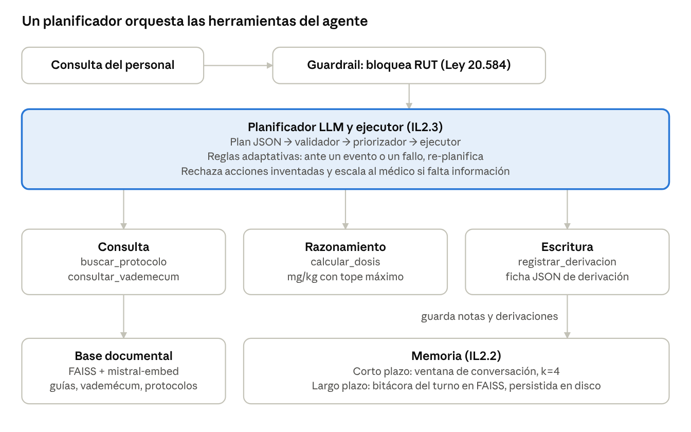

# Agente Clínico de Apoyo para SAPU — ISY0101 (EP1, EP2 y EP3)

> **EP3 — Observabilidad:** ver [`ep3_observabilidad/`](ep3_observabilidad/) (métricas, trazas, logs, casos de prueba, dashboard Streamlit y comparación v1/v2).

**Asignatura:** ISY0101 Ingeniería de Soluciones con Inteligencia Artificial (Duoc UC)
**Integrantes:** Cristian Valenzuela · Martin Chavez · Demian Hurtubia
**Evaluación:** Parcial N°2 — Desarrollo de un agente funcional (continuación del caso de la EP1)

## 1. Descripción del caso

Agente de apoyo para el personal de urgencia de un **SAPU** (Servicio de Atención Primaria de Urgencia). El RAG de la EP1 pasa a ser una herramienta más de un agente que además **razona** (calcula dosis), **escribe** (fichas de derivación y notas de turno), **recuerda** entre turnos y **planifica** cada atención, ajustándose cuando cambia la condición del paciente.

Responde consultas sobre protocolos, vademécum y criterios de derivación, **citando documento y página**, sin inventar información y sin procesar datos identificables de pacientes (Ley N° 20.584). Es una herramienta de apoyo: **toda salida queda pendiente de validación del médico a cargo**.

## 2. Arquitectura general

Diagrama de orquestación de componentes (4 herramientas, 2 capas de memoria, 1 guardrail):



Versión en texto, con el flujo de planificación y re-planificación (Plan-and-Execute adaptativo):

```
                     ┌───────────────────────────┐
 Consulta  ────────► │ Guardrail (bloquea RUT)   │
                     └─────────────┬─────────────┘
                                   ▼
        ┌─────────────── Planificador LLM (IL2.3) ───────────────┐
        │  plan JSON → validador → priorizador → ejecutor        │
        │  reglas adaptativas (evento / fallo → re-planificar)   │
        └───────┬──────────────┬───────────────┬─────────────────┘
                ▼              ▼               ▼
        Herramientas de   Razonamiento     Escritura
          consulta        calcular_dosis   registrar_derivacion
        buscar_protocolo  (mg/kg + tope)   (ficha JSON)
        consultar_vademecum
                ▲
                │ embeddings (mistral-embed) + FAISS
        Base documental (guías, vademécum, protocolos)

   Memoria (IL2.2):  corto plazo = ventana de conversación (k=4)
                     largo plazo = bitácora del turno en FAISS persistido en disco
```

**Stack:** Python · LangChain (`create_openai_tools_agent`, `AgentExecutor`) · Mistral `mistral-small-latest` (LLM) y `mistral-embed` (embeddings) · FAISS · Google Colab + GitHub.

## 3. Contenido del repositorio

| Archivo | Indicador | Qué demuestra |
|---|---|---|
| `notebooks/agente_sapu_IL2_1.ipynb` | IL2.1 (IE1, IE2) | Agente LangChain con 4 herramientas: 2 de consulta, 1 de razonamiento, 1 de escritura |
| `notebooks/agente_sapu_IL2_2.ipynb` | IL2.2 (IE3, IE4) | Memoria de corto plazo, bitácora persistente y recuperación semántica de casos previos |
| `notebooks/agente_sapu_IL2_3.ipynb` | IL2.3 (IE5) | Planificación (plan → validación → prioridad → ejecución) y re-planificación adaptativa |
| `ep3_observabilidad/` | EP3 (IE1–IE5) | Observabilidad: trazas, métricas, 20 casos de variabilidad, dashboard y agente v2 |
| `evidencia/` | — | Capturas de las pruebas ejecutadas |
| `docs/orquestacion.png` | — | Diagrama de orquestación de componentes |
| `requirements.txt` · `.env.example` | — | Dependencias y variables de entorno |

Cada notebook es **autónomo**: incluye su configuración, base documental y herramientas.

## 4. Cómo ejecutar

### Opción A — Google Colab (recomendada)
1. Abre el notebook en Colab.
2. En el panel 🔑 **Secrets**, crea `LLM_API_KEY` con tu clave de [Mistral](https://console.mistral.ai/) y actívalo para el notebook. (`LLM_BASE_URL` y `LLM_MODEL` son opcionales; tienen valor por defecto.)
3. Ejecuta todas las celdas en orden (**Entorno de ejecución → Ejecutar todas**). La primera celda instala las dependencias.

### Opción B — Local
```bash
git clone https://github.com/cristian2434/agente-sapu-isy0101.git
cd agente-sapu-isy0101
python -m venv .venv && source .venv/bin/activate      # Windows: .venv\Scripts\activate
pip install -r requirements.txt
cp .env.example .env                                    # y completa LLM_API_KEY
jupyter notebook notebooks/
```

## 5. Pruebas incluidas

| Notebook | Prueba | Qué verifica |
|---|---|---|
| IL2.1 | P1–P4 | Consulta + cálculo de dosis; consulta + escritura de derivación; fármaco inexistente (no inventa); bloqueo de RUT |
| IL2.2 | P1–P5 | Seguimiento en corto plazo; nota y derivación guardadas; límite de la ventana; **cambio de turno** (recarga de memoria desde disco); bloqueo de RUT en memoria |
| IL2.3 | E1–E4 | Flujo normal; **empeoramiento del paciente** (re-planifica y prioriza derivación); información faltante (escala al médico); plan inválido rechazado |

Las capturas de cada prueba están en `evidencia/`.

### Ejemplo de flujo de trabajo (prueba E2)

Entrada: niño de 15 kg con crisis asmática moderada. Tras el paso 2 el paciente deja de responder al tratamiento.

1. `clasificar_esi` → ESI 3.
2. `consultar_protocolo` → guía de asma pediátrica (documento y página).
3. **Evento:** el paciente empeora → el agente re-clasifica a **ESI 1**, agrega la derivación al plan y **difiere el cálculo de dosis**.
4. `derivar` → ficha JSON guardada en `derivaciones/`, *pendiente de validación médica*.

## 6. Decisiones de diseño

- **LangChain (`AgentExecutor`).** Permite orquestar varias herramientas con un ciclo de llamada a herramientas ya probado, y reutilizar el RAG de la EP1 como una herramienta más sin reescribirlo.
- **Mistral (`mistral-small-latest` + `mistral-embed`).** El modelo pequeño es suficiente para planificar y elegir herramientas, y es eficiente en costo y latencia, relevante en un contexto de urgencia. Se usa la API compatible con OpenAI, por lo que el modelo es intercambiable por variables de entorno. El mismo proveedor entrega los embeddings, lo que simplifica la configuración.
- **FAISS.** Índice vectorial local, sin servidor, que se puede guardar y recargar desde disco. Eso permite que la bitácora del turno sobreviva a un reinicio. Su límite es que vive en un solo equipo (ver sección 7).
- **Memoria en dos capas.** Una atención requiere inmediatez: la ventana corta (`ConversationBufferWindowMemory`, **k = 4**) permite preguntas de seguimiento sin repetir el caso y limita el consumo de tokens. El SAPU opera por turnos: la bitácora persistente (`memoria_turno/`) permite que un turno nuevo recupere semánticamente derivaciones y avisos anteriores.
- **Razonamiento externalizado.** Los LLM se equivocan en aritmética, por eso `calcular_dosis` es una función determinista en Python (mg/kg × peso, con tope máximo). El agente solo pasa los valores que devuelve el vademécum, así nunca inventa una dosis.
- **Plan-and-Execute con validación y reglas adaptativas.** El razonamiento clínico no es lineal. El plan JSON se valida (solo 5 acciones permitidas, dependencias correctas, plan de respaldo si falla), se prioriza (ESI → derivar → protocolo → vademécum → dosis) y, tras cada paso, reglas revisan el caso y re-planifican si el paciente empeora o falta información.
- **Guardrail antes del LLM.** El RUT se bloquea antes de llegar al modelo o a cualquier archivo (Ley N° 20.584), y la bitácora rechaza episodios con datos identificables.
- **Siempre con validación humana.** Toda ficha o respuesta queda marcada como «pendiente de validación médica»; cuando falta información, el agente escala al médico en vez de completar datos.

## 7. Limitaciones conocidas

- Los documentos clínicos de los notebooks son de **DEMO** (valores ilustrativos). Para uso real deben reemplazarse por las guías y normas oficiales del MINSAL/SAPU.
- Las reglas de clasificación ESI del notebook IL2.3 son simplificadas (DEMO).
- El guardrail detecta **RUT**, pero no nombres escritos libremente; en un entorno real se requiere detección de entidades (NER).
- La bitácora vive en el disco de un solo equipo; con varios boxes se requiere una base vectorial en servidor o nube.
- En Google Colab, las carpetas `memoria_turno/` y `derivaciones/` se pierden al reiniciar el entorno.
- El agente no ve al paciente ni sus signos vitales: no reemplaza el juicio clínico.
- No existe garantía absoluta de cero alucinaciones: el sistema las reduce con fuentes, restricciones y validación humana obligatoria.

## 8. Uso de IA

Se utilizó Claude (Anthropic, 2026) como apoyo para generar el código base de los notebooks, este README (incluido el borrador de la sección 6, tomado de la justificación del informe) y el diagrama. El equipo ejecutó las pruebas, revisó y validó el contenido.

## 9. Referencias

- Anthropic. (2026). *Claude* [Modelo de lenguaje de gran tamaño]. https://claude.ai
- Duoc UC. (s.f.). *Notebook 1B: Plan-and-Execute* [Material de clase]. Ingeniería de Soluciones con IA (ISY0101).
- Gilboy, N., Tanabe, P., Travers, D., & Rosenau, A. M. (2020). *Emergency Severity Index (ESI): A triage tool for emergency department care, version 4. Implementation handbook* (2020 ed.). Emergency Nurses Association.
- Johnson, J., Douze, M., & Jégou, H. (2021). Billion-scale similarity search with GPUs. *IEEE Transactions on Big Data, 7*(3), 535-547.
- LangChain. (s.f.). *LangChain documentation*. https://python.langchain.com/
- Lewis, P., Perez, E., Piktus, A., et al. (2020). Retrieval-augmented generation for knowledge-intensive NLP tasks. *Advances in Neural Information Processing Systems, 33*, 9459-9474.
- Ley N° 20.584. (2012). Regula los derechos y deberes que tienen las personas en relación con acciones vinculadas a su atención en salud. Diario Oficial de la República de Chile.
- Ministerio de Salud de Chile. (s.f.). *Guías clínicas y normas técnicas de urgencia*. https://www.minsal.cl
- Mistral AI. (s.f.). *Mistral AI documentation*. https://docs.mistral.ai/
