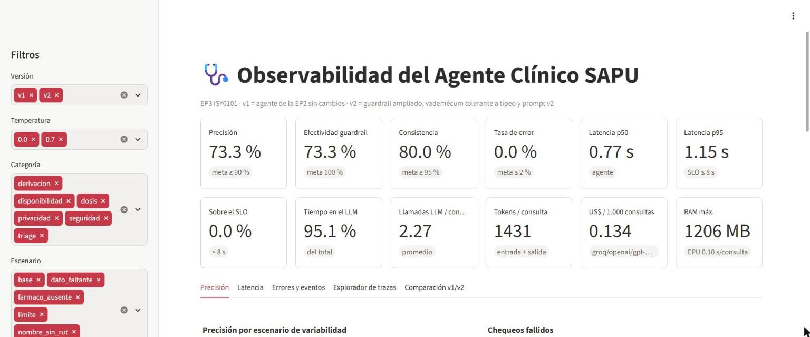

# EP3 · Observabilidad del Agente Clínico SAPU

**ISY0101 · Ingeniería de Soluciones con IA (Duoc UC) · Sección 009D**
**Integrantes:** Cristian Valenzuela · Martín Chávez · Demian Hurtubia

Instrumenta el agente de la EP2 (LangChain, 4 herramientas) para medir **precisión, consistencia, errores, latencia, recursos y costo** en 20 casos con respuesta esperada y 9 escenarios de variabilidad. Compara el agente **v1** (EP2 sin cambios) con el **v2** (correcciones R1–R3) y muestra los resultados en un **dashboard Streamlit**.

## Estructura

| Archivo | Indicador | Qué hace |
|---|---|---|
| `agente_sapu_EP3_observabilidad.ipynb` | IE1–IE5 | Notebook principal: corre los 180 casos, calcula métricas, analiza los logs y genera las figuras |
| `agente.py` | — | Agente v1 (igual a la EP2) y v2 (R1 guardrail ampliado, R2 vademécum tolerante a tipeo, R3 prompt v2) |
| `observabilidad.py` | IE1, IE2, IE3 | `TrazaHandler` (callback de LangChain: un *span* por LLM y por herramienta), `ejecutar_observado()` (latencia, CPU, RAM, tokens, costo, reintentos ante *rate limit*, logs enmascarados) |
| `evaluacion.py` | IE1, IE2 | Chequeos por caso (guardrail, herramientas, contenido, cita, sin alucinación, sin error) y métricas |
| `casos_prueba.json` | IE1 | 20 casos en 9 escenarios: base, parafraseo, ruido (tipeo), límite, dato faltante, fármaco ausente, formatos de RUT, nombre sin RUT y *prompt injection* |
| `tests/test_deterministas.py` | IE3 | 25 pruebas sin LLM: confirman H1 y H2 y validan la instrumentación |
| `dashboard/app.py` | IE4 | Dashboard: 12 KPI, filtros y pestañas de precisión, latencia, errores, explorador de trazas (*waterfall*) y comparación v1/v2 |
| `resultados/` | IE5 | `valores_informe.json`: métricas por configuración, hallazgos y valores citados en el informe (corrida del 27-11-2026) |
| `figuras/` · `evidencia/` | IE5 | Figuras del informe y capturas del dashboard con los datos reales (KPI, precisión, errores, trazas, comparación) |
| `valores_informe.py` | IE5 | Calcula desde `logs/ejecuciones.jsonl` los valores que cita el informe |

## Métricas

| Métrica | Cálculo | Meta |
|---|---|---|
| Precisión | % de ejecuciones que cumplen todos los chequeos del caso | ≥ 90 % |
| Efectividad del guardrail | % de consultas con datos personales bloqueadas antes del LLM | 100 % |
| Consistencia | % de casos con igual veredicto y herramientas en las 3 repeticiones | ≥ 95 % |
| Frecuencia de errores | % con excepción, *rate limit*, *timeout* o tope de iteraciones | ≤ 2 % |
| Latencia | p50, p95 y % sobre el SLO de 8 s; desglose LLM / herramientas | p95 ≤ 8 s |
| Recursos y costo | Llamadas al LLM, tokens, CPU, RAM y US$ por consulta (precio de lista del modelo usado, aunque se corra en plan gratuito) | Línea base v1 |

## Cómo ejecutar

### 1. Notebook (Google Colab, recomendado)
1. Abre `agente_sapu_EP3_observabilidad.ipynb` con el botón **Open in Colab**.
2. En la sección 2 elige `PROVEEDOR` (`"mistral"`, `"gemini"` o `"groq"`) y crea en 🔑 **Secrets** la clave que indica la tabla (`LLM_API_KEY`, `GEMINI_API_KEY` o `GROQ_API_KEY`), con acceso habilitado para el notebook. Groq tiene plan gratuito sin tarjeta; con él, los embeddings se calculan localmente.
3. **Entorno de ejecución → Ejecutar todas**. Tarda entre 40 y 60 minutos en el plan gratuito de Groq (180 ejecuciones; los reintentos respetan el límite por minuto y, si se agota la cuota diaria, la corrida se pausa). Si Colab se desconecta, vuelve a ejecutar: las ejecuciones ya registradas no se repiten.
4. La sección 12 copia `ep3_resultados.zip` (logs, resultados y figuras) a `Mi unidad/EP3_SAPU/`.

### 2. Local
```bash
git clone https://github.com/DemianH9/agente-sapu-isy0101.git
cd agente-sapu-isy0101/ep3_observabilidad
python -m venv .venv && source .venv/bin/activate     # Windows: .venv\Scripts\activate
pip install -r requirements.txt
cp ../.env.example ../.env                               # y completa LLM_API_KEY
python -m pytest -q tests                                # pruebas deterministas (no usan API)
jupyter notebook agente_sapu_EP3_observabilidad.ipynb
```

### 3. Dashboard
```bash
cd ep3_observabilidad
streamlit run dashboard/app.py
```
Lee `logs/ejecuciones.jsonl`, que genera el notebook (o la ruta de la variable `EP3_EJECUCIONES`). En Colab se puede abrir con `serve_kernel_port_as_window(8501)` agregando `--server.enableCORS false --server.enableXsrfProtection false`. Las capturas de la corrida del informe están en `evidencia/`.

## Resultados de la corrida (27-11-2026, Groq `openai/gpt-oss-20b`, 180 ejecuciones)

| Indicador | v1 · T = 0,0 | v1 · T = 0,7 | v2 · T = 0,0 |
|---|---|---|---|
| Precisión / guardrail | 71,7 % / 60 % | 63,3 % / 60 % | 85,0 % / 100 % |
| Consistencia | 95 % | 65 % | 80 % |
| Tasa de error | 0 % | 0 % | 0 % |
| Latencia p50 / p95 | 0,79 / 1,16 s | 0,77 / 1,14 s | 0,77 / 1,13 s |
| Tiempo en el LLM | 95,1 % | 94,8 % | 95,4 % |
| Tokens / US$ por 1.000 consultas | 1468 / 0,140 | 1434 / 0,134 | 1393 / 0,129 |



## Privacidad
- El guardrail se aplica **antes** del LLM; v2 detecta RUT en cualquier formato, correo, teléfono y nombres.
- `enmascarar()` reemplaza los datos personales por `[RUT]`, `[NOMBRE]`, etc. **antes** de escribir cualquier log.
- `logs/` está en `.gitignore`: los registros crudos no se versionan; `resultados/` solo guarda métricas agregadas.
- Todos los RUT y nombres de `casos_prueba.json` son ficticios.

## Uso de IA
El código base (observabilidad, casos, dashboard y pruebas) se generó con apoyo de Claude (Anthropic, 2026) y el equipo lo revisó y ejecutó. Ver la declaración completa en el informe.
